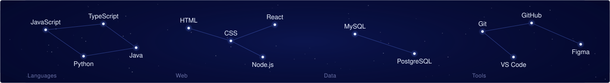
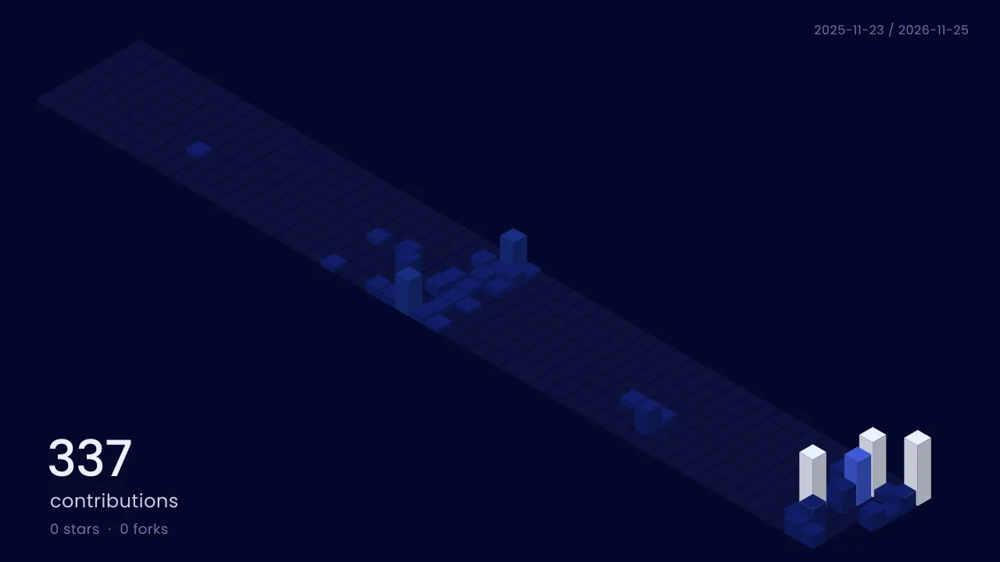

<!-- ============ KHUNG HOA HỒNG (trên) ============ -->

  

<!-- ============ TYPING ============ -->

  

<!-- ============ BADGES LIÊN HỆ (không logo) ============ -->

  
  
  

### About me

- Information Systems student at **University of Information Technology (UIT) – VNU-HCM**
- Heading toward **Data Analyst / Data Engineer / AI Engineer** roles
- Keen to get involved in scientific research
- MBTI: **ENTP**
- Deadly sin of choice: **Ego**
- Into music, movies, gaming, the gym, video editing and photography
- Reach me: **thuatsichanh@gmail.com**

 

### Selected projects

<!-- Thẻ dự án: scripts/projects.py tạo từ scripts/projects.json (workflow profile-3d.yml cập nhật mỗi ngày) -->
<!-- PROJECTS:START -->

  

<!-- PROJECTS:END -->

### Tech stack

<!-- Bản đồ chòm sao: mỗi nhóm là một chòm, mỗi công nghệ là một ngôi sao (sửa tên trong assets/tech-stack.svg) -->

  

### GitHub stats

<!-- 3 thẻ trên cùng 1 dòng: width % tính theo tỉ lệ khung của từng thẻ để chiều cao gần bằng nhau -->

  
  
  <!-- fire=00000000: ẩn biểu tượng ngọn lửa -->
  

### Contribution calendar (3D)

<!-- Tạo bởi workflow .github/workflows/profile-3d.yml; scripts/make_3d_anim.py dựng thành WebP động (16:9, sóng, font Poppins) -->

  

### On repeat

<!-- ============ NOW PLAYING: tự đổi bài mỗi giờ từ playlist YouTube "4github" (workflow now-playing.yml cập nhật khối dưới) ============ -->
<!-- NOW-PLAYING:START -->

  

<!-- NOW-PLAYING:END -->

<!-- ============ KHUNG HOA HỒNG (dưới) ============ -->

  

