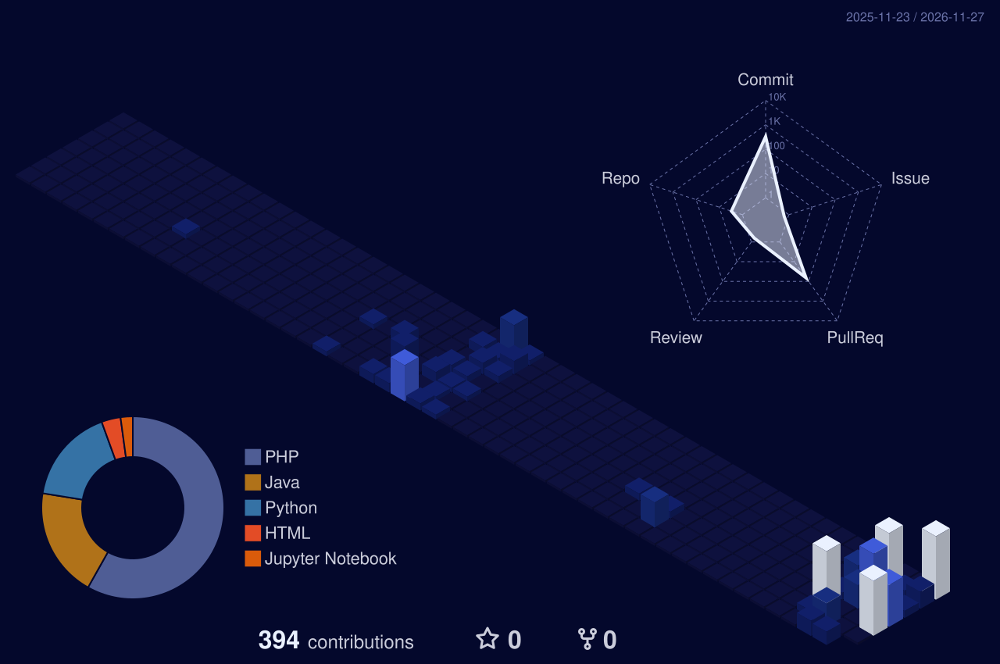

<!-- ============ KHUNG HOA HỒNG (trên) ============ -->

  

<!-- ============ TYPING ============ -->

  

<!-- ============ BADGES LIÊN HỆ (không logo) ============ -->

  
  
  

### About me

- Student at **University of Information Technology (UIT) – VNU-HCM**, major: **Information Systems**
- Working on course projects: web development, system analysis & design, databases
- Getting into scientific research (NCKH)
- Improving my English every day
- Reach me: **thuatsichanh@gmail.com**

### Tech stack

`HTML` `CSS` `JavaScript` `TypeScript` `React` `Node.js` `Python` `Java` `MySQL` `PostgreSQL` `Git` `GitHub` `VS Code` `Figma`

### GitHub stats

  
  

  <!-- fire=00000000: ẩn biểu tượng ngọn lửa -->
  

### Contribution calendar (3D)

<!-- Tạo bởi workflow .github/workflows/profile-3d.yml, sau đó scripts/restyle_3d.py chỉnh khung 16:9 + font -->

  

<!-- ============ KHUNG HOA HỒNG (dưới) ============ -->

  

